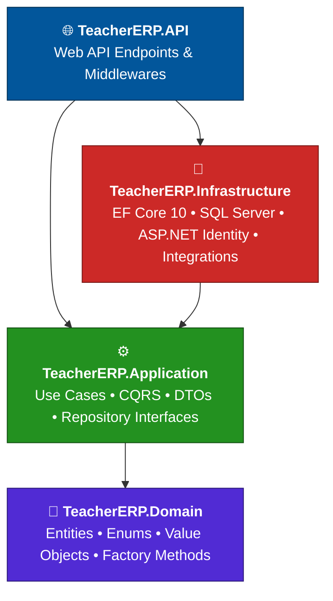

<div align="center">

<br />

# 🏫 Smart Teacher ERP

### Center Management System

**The next-generation, zero-hardware enterprise solution for educational centers & private tutors**

<br />

<p align="center">
  
  
  
  
  
</p>

<p align="center">
  <b>Zero manual data entry</b> &nbsp;•&nbsp; <b>Strict financial privacy</b> &nbsp;•&nbsp; <b>Hybrid anti-cheat attendance</b>
</p>

<p align="center">
  <a href="#-vision">Vision</a> •
  <a href="#%EF%B8%8F-architecture">Architecture</a> •
  <a href="#%EF%B8%8F-core-features">Features</a> •
  <a href="#%EF%B8%8F-database-schema">Database</a> •
  <a href="#-getting-started">Getting Started</a> •
  <a href="#-author">Author</a>
</p>

</div>

<br />

---

## 🎯 Vision

> Managing private educational centers (**سناتر**) usually suffers from **massive data-entry friction**, **financial leaks**, and **complex attendance tracking**.

**Smart Teacher ERP** is engineered from scratch to solve exactly these enterprise pain points through robust backend design, strict security policies, and high scalability.

<table align="center">
  <tr>
    <td align="center" width="33%">
      <h3>⌨️</h3>
      <b>Zero Data Entry</b><br/>
      <sub>Less typing, fewer errors</sub>
    </td>
    <td align="center" width="33%">
      <h3>💰</h3>
      <b>Financial Privacy</b><br/>
      <sub>Money is visible only to those trusted with it</sub>
    </td>
    <td align="center" width="33%">
      <h3>📍</h3>
      <b>Anti-Cheat Attendance</b><br/>
      <sub>Geofenced, fake-GPS-proof</sub>
    </td>
  </tr>
</table>

---

## 🏛️ Architecture

The solution strictly follows **Clean / Onion Architecture**, keeping an absolute separation of concerns across layers.



### 📦 Solution Structure

```text
📂 TeacherERP.sln
 ┣━ 📂 TeacherERP.Domain          # Core entities, enums, value objects & factory methods (zero dependencies)
 ┣━ 📂 TeacherERP.Application     # Business use cases, CQRS, DTOs & repository interfaces
 ┣━ 📂 TeacherERP.Infrastructure  # EF Core 10, SQL Server, ASP.NET Identity & external integrations
 ┗━ 📂 TeacherERP.API             # Presentation layer (Web API endpoints & middlewares)
```

---

## 🛡️ Core Features

### 🔒 1. Advanced Security & Session Control

| | Capability | Details |
|:-:|---|---|
| 👤 | **ASP.NET Core Identity** | Custom `ApplicationUser` inheriting from `IdentityUser<Guid>` to manage students, assistants, and super admins seamlessly. |
| 🔑 | **JWT & Refresh Token Rotation** | Device-informed session tracking that allows **instant token revocation** — e.g. forcefully logging out a terminated assistant in real time. |

### 📍 2. Hybrid Anti-Cheat Attendance System

| | Capability | Details |
|:-:|---|---|
| 🛰️ | **Self-Scan via GPS Geofencing** | Students scan the center's QR code; the backend validates their coordinates against the center's latitude/longitude, with strict **Mock Location (Fake GPS) rejection**. |
| 📴 | **Offline / Alternative Fallbacks** | Assistants can scan static student QR cards or log manual entries for emergency cases. |
| 🔄 | **Smart Compensation Flow** | Makeup classes are handled through pending requests that require assistant approval. |
| 🚫 | **Auto-Suspension Engine** | Automatically penalizes students after consecutive absences. |

### 💰 3. Strict Financial Ledger & Privacy

| | Capability | Details |
|:-:|---|---|
| 🧾 | **Granular Financial Delegation** | Assistants have restricted visibility over funds and debts **unless** the Super Admin explicitly grants `HasFinancialDelegation == true`. |
| 💳 | **Flexible Payment Types** | Supports per-session payments, monthly subscriptions, and debt settlements. |
| 📲 | **Digital Receipts** | Manages InstaPay / E-wallet receipts that require Super Admin approval. |

---

## 🗄️ Database Schema

Managed via **Entity Framework Core 10** with optimized Fluent API configurations to prevent *multiple cascade path* anomalies in SQL Server.

| Table | Purpose |
|---|---|
| 👥 **`AspNetUsers` / `ApplicationUser`** | Unified user base with role traits |
| 🔐 **`RefreshTokens`** | Secure session management |
| ⚙️ **`TenantSettings`** | Geofencing configuration and attendance modes |
| 🏷️ **`Groups`** | Class structures with recurring schedule days |
| 🔗 **`GroupAdmins`** | Many-to-many mapping of assistants to strict group boundaries |
| 📅 **`Sessions`** | Auto-generated class instances tracking board images and homework timelines |
| ✅ **`AttendanceRecords`** | Hybrid verification logs |
| 💵 **`Transactions`** | Smart financial ledger |

---

## 🚀 Getting Started

### 📋 Prerequisites

| Requirement | Link |
|---|---|
| **.NET 10 SDK** | [Download](https://dotnet.microsoft.com/download) |
| **SQL Server** | [Download](https://www.microsoft.com/sql-server/sql-server-downloads) |
| **Git** | [Download](https://git-scm.com/downloads) |

### ⚡ Installation & Run

**1️⃣ Clone the repository**

```bash
git clone https://github.com/Ahmed-Al-Desouki/TeacherERP.git
cd TeacherERP
```

**2️⃣ Configure the connection string**

Set your connection string in `appsettings.json` under `TeacherERP.API`.

**3️⃣ Apply database migrations**

```bash
dotnet ef database update --project TeacherERP.Infrastructure --startup-project TeacherERP.API
```

**4️⃣ Run the API**

```bash
dotnet run --project TeacherERP.API/TeacherERP.API.csproj
```

---

## 👨‍💻 Author

<div align="center">

<a href="https://github.com/Ahmed-Al-Desouki">
  
</a>

### Ahmed Al-Desouki
**.NET Developer & Software Architect**

<a href="https://github.com/Ahmed-Al-Desouki">
  
</a>

<br /><br />

<sub>⭐ If you find this project interesting, consider giving it a star!</sub>

</div>
